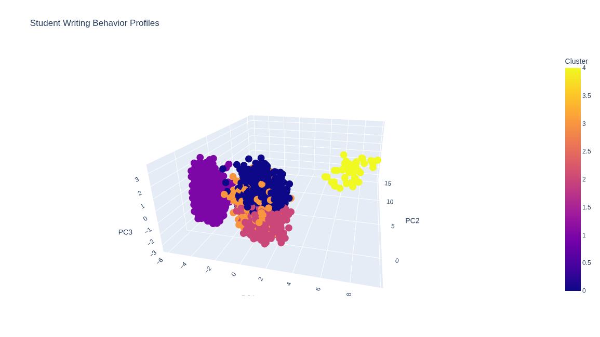
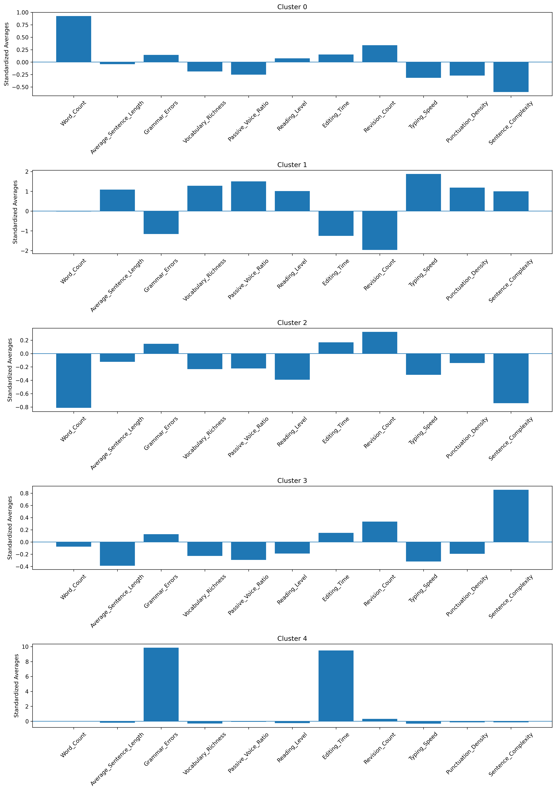
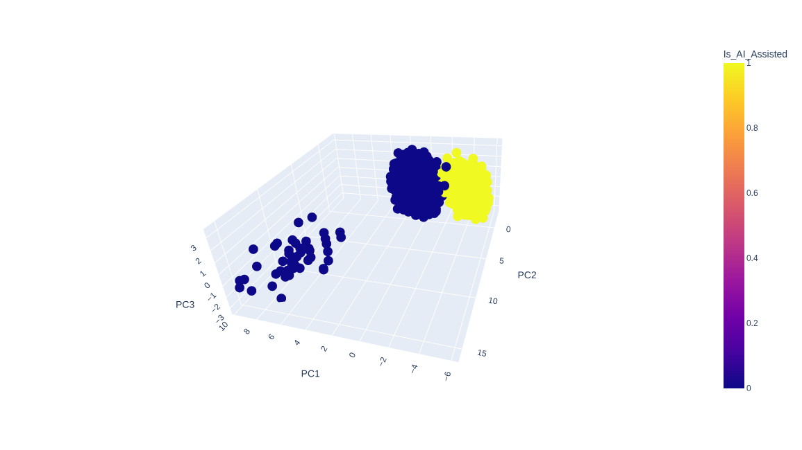
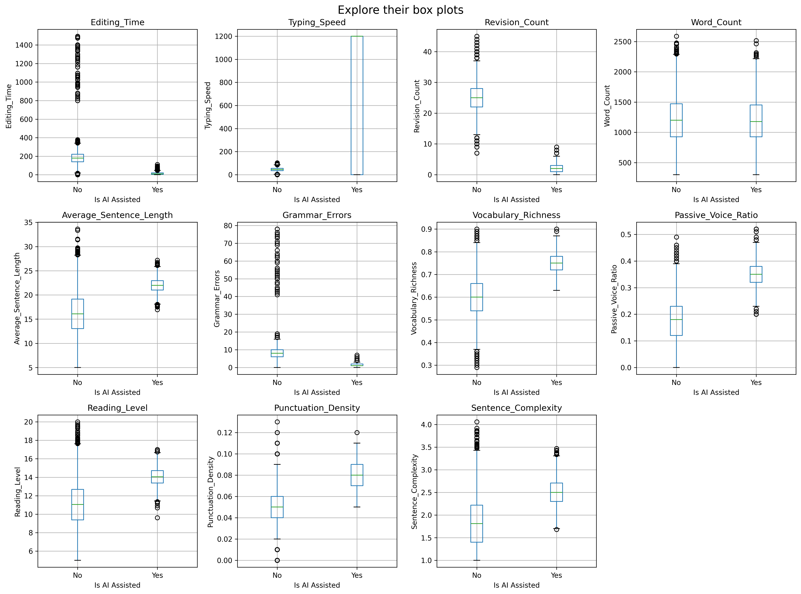

# Is_AI_Assisted-data-exploration

Applied dimensionality reduction and clustering to find patterns in this dataset, but apparently the data was generated and have an unrealistic small bias, so I found a perfect clusters predicting if its AI assisted or not. 

Students writing behaviors: (purple clusters are AI assisted students behaviors)

Each cluster's columns averages:

Perfect and unrealistic classification:

I investigated the columns and found very strong relationships causing the perfect classification: 

